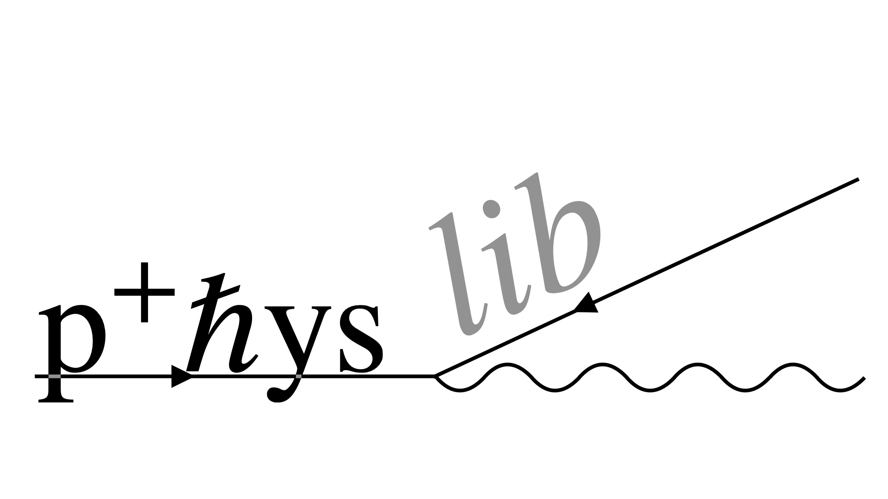

<div align="center">


# Entropic Physlib

**A Lean 4 research fork of [Physlib](https://github.com/leanprover-community/physlib) for
entropic gravity and machine-auditable physical reasoning.**

[](https://github.com/leanprover/lean4/releases/tag/v4.33.0)
[](./LICENSE)

</div>

## What this repository is

This is a research fork of the community [Physlib](https://github.com/leanprover-community/physlib)
project (the Lean physics library). It tracks upstream's codebase and review standards and adds,
on top of them:

- **The entropic-gravity program** (`Physlib/QuantumMechanics/ComplexAction/`, `Physlib/Thermodynamics/`):
  a formalization of the information-theoretic route to gravitation — Verlinde's entropic force,
  the Compton-clock/Gaussian–Fisher screen construction, holographic coupling uniqueness and
  rigidity theorems, horizon consistency, and the path-integral bit-processing ledger.
  The central results are stated as *conditional uniqueness and equivalence theorems*, with their
  premises tracked explicitly (see *Epistemic status* below).
- **The ZIL knowledge graph** (`Physlib/Meta/ZilGraph.lean` and friends): every physical claim in
  the program carries machine-readable `zil attach` metadata (`formalizes`, `supported_by`,
  `derives`, `caveat`, `discloses`, `epistemic_status`), audited by a stratified-negation Datalog
  engine whose fast evaluator is itself proved equal to its reference semantics in Lean
  (`Physlib/Meta/ZilDatalogFastEquiv.lean`).
- **The audit pipeline** (`scripts/zil-graph-report.sh` → [`analysis/zil-graph-report.md`](analysis/zil-graph-report.md)):
  a full-root sweep that reports unsupported claims, buried conditionality (exact-status claims
  transitively resting on undisclosed weaker-status premises), the primitive-premise ledger, and
  per-sector axiom-cleanliness and non-vacuity certificates.

The tree contains **no `sorry` and no `axiom` declarations** (enforced by [AGENTS.md](AGENTS.md)
and checked in review).

## Building

Requires [elan](https://github.com/leanprover/elan); the toolchain (Lean v4.33.0) and all
dependencies (mathlib, zil-lean) are pinned.

```bash
lake exe cache get   # fetch the mathlib build cache
lake build           # builds the default targets: Physlib and QuantumInfo
lake build PhyslibAlpha
```

## Auditing

```bash
./scripts/zil-graph-report.sh                       # regenerate analysis/zil-graph-report.md
ZIL_LEAN_DIR=/path/to/zil-lean ./scripts/zil-check.sh   # validate the .zc graphs (needs a zil-lean checkout)
```

A guided tour of the program — layer by layer, with the honest premise ledger — is in
[docs/EntropicGravityProgram.md](docs/EntropicGravityProgram.md).

## Epistemic status

This is a research program, and the repository is deliberately explicit about what is and is not
established. The current state is machine-generated in
[`analysis/zil-graph-report.md`](analysis/zil-graph-report.md); the standing working documents
(claim triage, unsupported-claims worklist, gold corpus) live in [`analysis/`](analysis/).
Headline discipline:

- Physical-identification results are stated as **conditional equivalences and uniqueness
  theorems**, never as premise-free derivations; every such claim carries a `caveat` naming its
  premises, and the buried-conditionality detector keeps that disclosure honest (currently `0`).
- Claims whose grounding still awaits human bibliographic verification are tracked openly in
  [`analysis/unsupported-claims-worklist.md`](analysis/unsupported-claims-worklist.md).

## AI disclosure

Substantial parts of this fork's added corpus were developed with AI assistance under the
human-certification contract in [AI-POLICY.md](AI-POLICY.md) (agent-facing rules in
[AGENTS.md](AGENTS.md)): a clean build proves what was written; the human author certifies that
what was written is what was meant, and all bibliographic verification is done by humans.

## Relationship to upstream

Upstream Physlib is a community project; this fork is independent research built on it. Issues and
PRs about the base library belong upstream; contributions to the entropic program belong here and
follow the same review standards ([docs/ReviewGuidelines.md](docs/ReviewGuidelines.md)).

## License

[Apache 2.0](./LICENSE), as upstream. See [CITATION.cff](CITATION.cff) for how to cite this work
and the upstream project it builds on.
